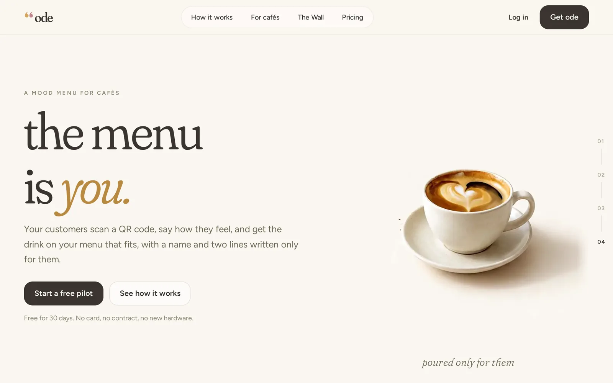
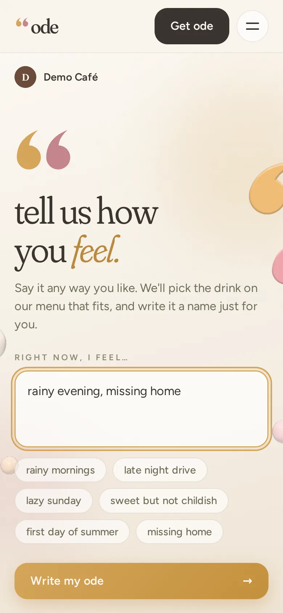
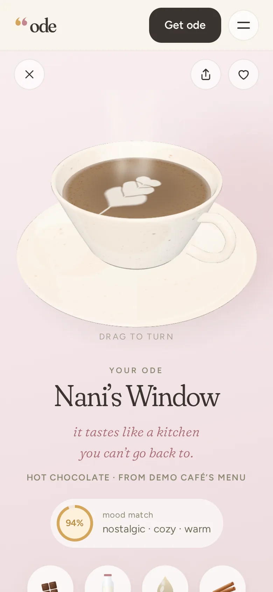
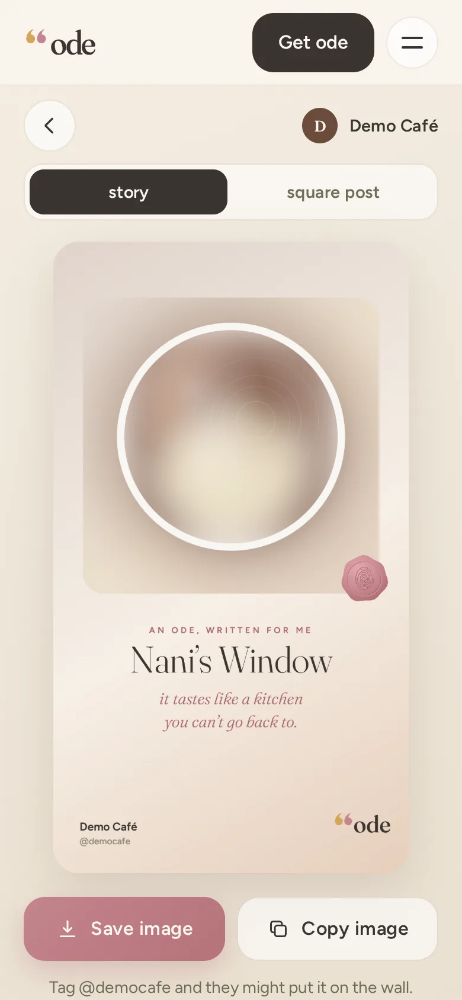
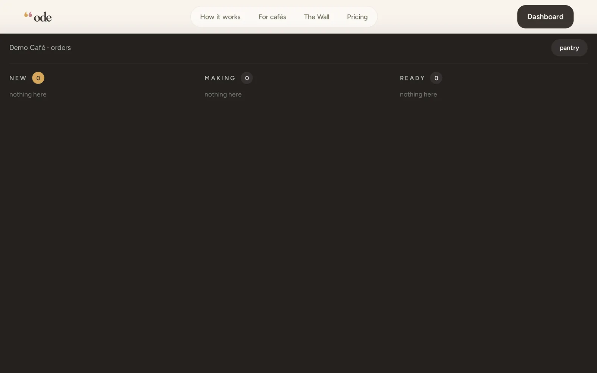
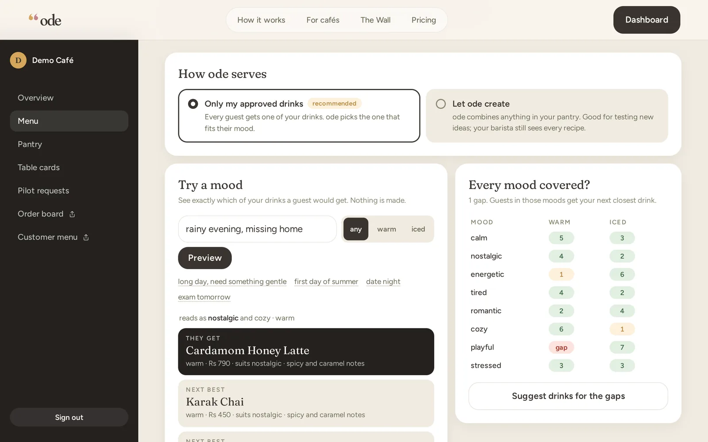
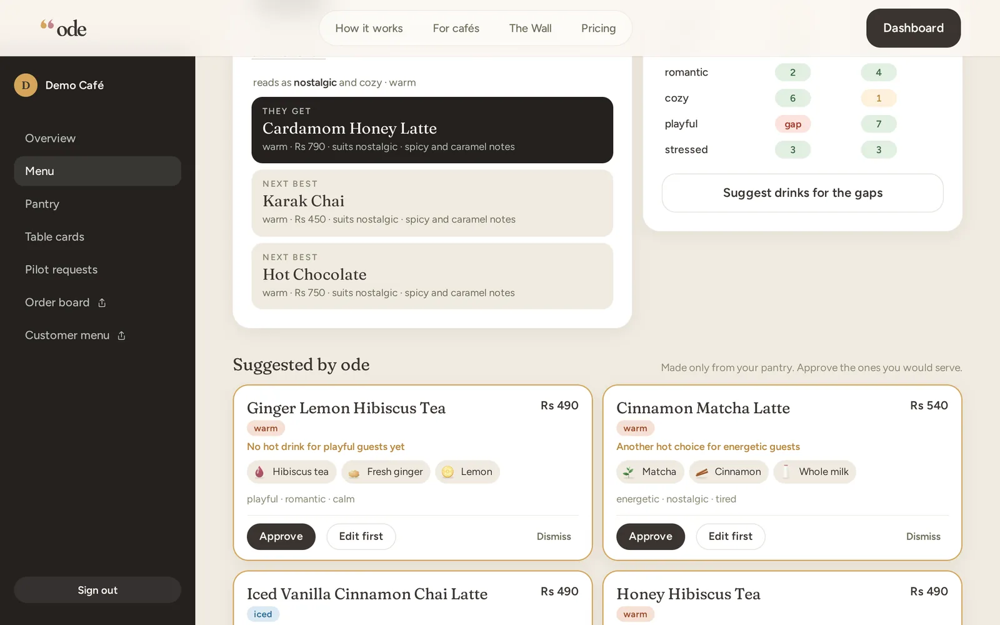
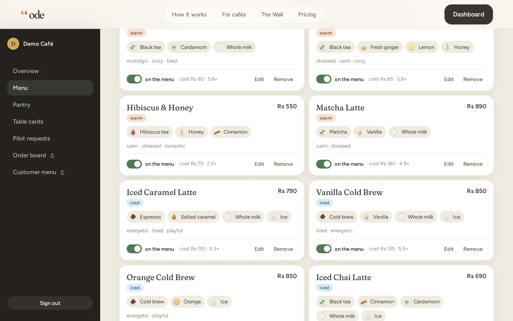

<div align="center">

# ode.

*the menu is you.*

A mood menu for cafés: guests say how they feel and get a drink from the café's own approved menu, with a name and two lines written just for them.

**[Live site](https://ode-gamma.vercel.app)** · **[Try the guest menu](https://ode-gamma.vercel.app/c/demo)**



</div>

## About

A customer scans a QR code at the table and says how they feel, in their own words. ode picks the drink on the café's menu that fits, checks it against their allergies and what is in stock, and gives it a name and two lines written only for them. The order lands on the barista's board with the exact recipe; the customer pays at the counter as usual. The owner approves every drink that can ever be served.

## Screens

<table>
  <tr>
    <td width="33%"></td>
    <td width="33%"></td>
    <td width="33%"></td>
  </tr>
  <tr>
    <td align="center">Say how you feel</td>
    <td align="center">Your ode, from the café's menu</td>
    <td align="center">A story card to share</td>
  </tr>
</table>

| Barista board | Menu tab: preview a mood |
| --- | --- |
|  |  |
| **Suggestions the owner approves** | **Approved drinks, costs and margins** |
|  |  |

## What's here

| Folder | What it is |
| --- | --- |
| `app/` | The web app (React + Vite): customer flow, share cards, saved odes, barista board |
| `app/api/` | The API (FastAPI): writes each ode, takes orders, runs the board and the pantry |
| `design/` | Brand boards and the brand's generators: the quotation-drop mark, flavour portraits, painted ingredients |

### Website
- **`/`**: a scroll-driven opening scene (a bean falls, the grounds swirl into the cup and a latte forms), three steps, a live try-it with the 3D cup, the order board and the Wall
- **`/how-it-works`**: six steps beside a live phone running the real menu, and how ode keeps the rules strict
- **`/for-cafes`**: the café's own menu matched to a guest's mood, a live order board, a pantry you can switch out of stock, a price calculator and a table card designer with a working QR code
- **`/wall`**: a Pinterest-style wall of odes, filterable by mood, each opening into its ingredients and price
- **`/pricing`**: a free 30-day pilot, the founding-café plan, the standard plan and multi-branch
- **`/get-ode`**: the pilot request form (saved to the `leads` table)
- **`/login`**: two separate doors: customers (sign in or create an account) and the café team (café ID and key)
- **`/account`**: a customer's saved odes, order history and taste
- **`/dashboard`**: the café team's overview (orders, sales, ratings, moods, busiest ingredients), menu, pantry, table cards and pilot requests

The Wall's photos are rendered by a small 3D studio (`src/three/still.js`) at `/kit/stills` and saved to `public/wall/`.

### Customer (`/c/demo`)
- **Tell us how you feel**: free text or an example, then optional mood, temperature, sweetness and flavours
- **Anything we must avoid**: dietary needs and allergies, enforced as hard rules and shown to the barista in red
- **Your ode**: name, two lines, a generated portrait, mood match, painted ingredients, size and price
- **Order**: an order code with live status, then a rating
- **Share**: a 9:16 story or square post image with the café's name and handle
- **My odes**: everything saved

### Café
- **Barista board** (`/barista`): new → making → ready, ingredients with amounts, method and steps, a chime for new orders
- **Pantry**: switch ingredients out of stock; new drinks stop using them immediately
- **Menu** (dashboard): the café's own drinks with their recipes and prices. In approved mode, the default, every guest gets one of these. Owners add and edit drinks, switch them off, see which moods have no warm or iced drink yet, approve or dismiss drinks ode suggests from the pantry, and preview which drink a guest with a given mood would get

## How an ode is written

Three stages, each one checked before anyone sees it:

1. **Read the mood.** The model reads what the customer wrote. Their own taps (mood, temperature, flavours) always win over its reading.
2. **Choose the drink.** In approved mode (the default) the drink is one of the café's own approved recipes. Code keeps only the ones that can be made right now (in stock, at this temperature, safe for this person; milk becomes oat milk for dairy-free guests) and ranks them by mood and flavour. The model may only pick among the best few, by id. In open mode the café lets ode compose: code narrows the pantry to what is allowed and the model chooses from that list only, then code checks the drink (one base, at most one milk, no milk with sparkling water, every flavour asked for, steps that mention only what is in the cup and no amounts).
3. **Write the lines.** A name and two lines, checked for length and voice: lowercase, no dashes, emoji or cliches. Words that moderation flags are never echoed back.

A rejected answer goes back once with the reasons. If it fails again, or the model is slow or missing, that stage falls back to the rules engine. Recipes, portions and prices are always the café's, never the model's, and the customer's phone sees ingredient names only. If nothing on the menu can be served for a guest (for example everything iced needs ice and ice is out), they are told kindly instead of being given something the café never approved.

## Run it

```bash
cd app
npm install
npm run dev
```

Open `/` for the website, `/c/demo` for the customer menu (what a table QR code opens) and `/barista` in another tab. Without the API, everything runs on the device (drinks from the rules engine, orders shared between tabs).

With the API:

```bash
cd app
pip install -r requirements.txt uvicorn
cd api && uvicorn index:app --port 8000          # memory store, no model: rules engine
ODE_API=http://localhost:8000 npm run dev         # in app/, in another terminal
```

Tests (39, covering every path of the pipeline with a scripted model, approval mode, stock, diet swaps and staff access; set `TEST_DATABASE_URL` to run them on Postgres):

```bash
cd app && pip install pytest httpx && pytest tests
```

## Deploy (Vercel)

One project, root directory `app`. Vercel builds the app and serves `api/index.py` as a Python function at `/api`.

Environment variables, set in Vercel only:

| Name | What it does |
| --- | --- |
| `OPENAI_API_KEY` | Turns the model on. Without it every drink comes from the rules engine |
| `DATABASE_URL` | Postgres connection string (Neon, pooled). Tables are created on first run |
| `ODE_STAFF_KEY` | The café key: the café team signs in with it at `/login` (I run a café) |
| `ODE_SECRET` | Recommended: a long random value that signs customer and team sessions |
| `ODE_ADMIN_KEY` | Optional: a separate owner key that also sees pilot requests. Without it, the café key does |
| `ODE_MODEL` | Optional, defaults to `gpt-4o-mini` |
| `ODE_DAILY_MODEL_LIMIT` | Optional, odes per café per day written by the model (default 400); after that, the rules engine |

## Status

Live at [ode-gamma.vercel.app](https://ode-gamma.vercel.app). In: the customer flow, accounts, the barista board, the owner dashboard (overview, menu approval, pantry, table cards) and the API. Next: menu import from a photo, specials from much-loved odes, and the café wall.
